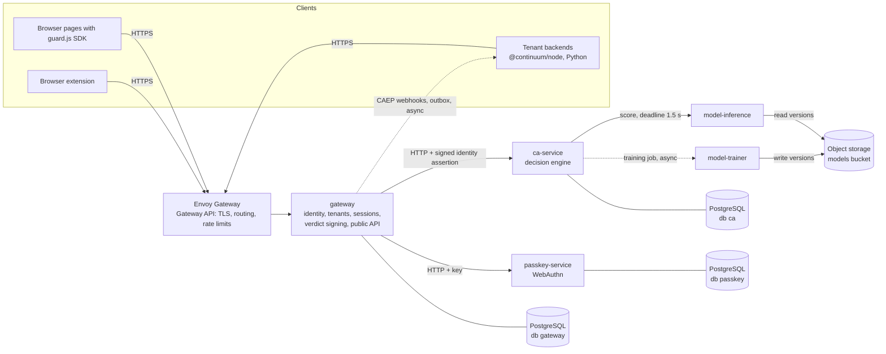
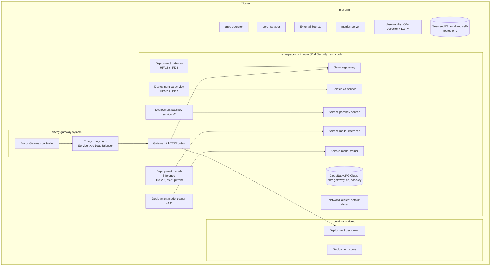
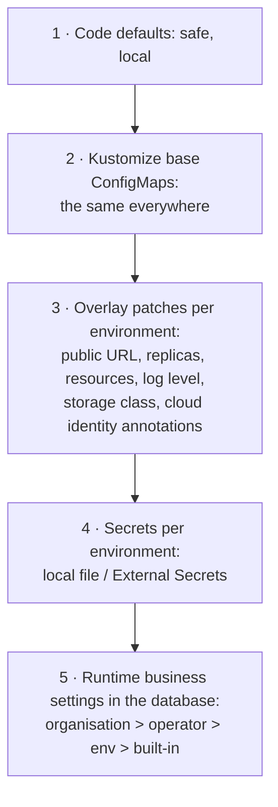
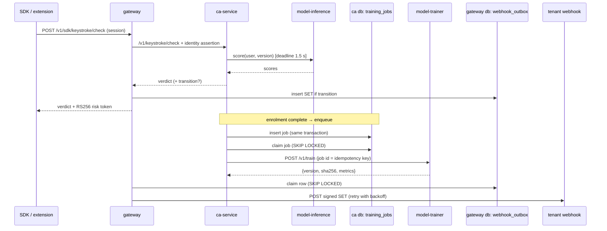
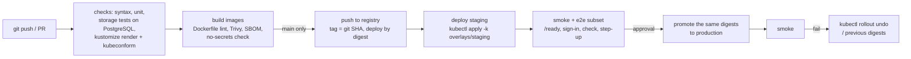

# Continuum — target cloud-native architecture

Status: decided 2026-10-07 (branch `cloud-native`). Step 1 of the migration (gateway storage) is built
and proven; the rest is the plan. Every choice below names the problem it solves; anything that solved
no concrete problem was left out.

Inputs: the current system (`ARCHITECTURE.md`, the code), the reference project
`C:\Ali\Learning Projects\final-ticketing`, and four changes in the ecosystem since that project was
built (sources at the end):

| Fact (checked 2026-10-07) | Consequence |
|---|---|
| **ingress-nginx is retired**: no releases or security fixes since March 2026 | Not used. Kubernetes **Gateway API** with **Envoy Gateway** instead |
| **Skaffold's repository will be archived on 29 Jan 2027** (Google Cloud Deploy docs) | Not used as the dev loop. Plain `kubectl apply -k` and a script (`scripts/k8s-local.sh`; the OWNER kept nothing installed on the PC, so not Tilt either); nothing in CI/CD depends on a dev tool |
| **MinIO community edition is archived** (no images since Oct 2025) | Local S3 storage is **SeaweedFS** (Apache 2.0) |
| **Bitnami's free images ended** (Aug–Sep 2025) | No Bitnami charts. PostgreSQL through **CloudNativePG** |
| **Node.js 20 reached end of life** (30 Apr 2026); our services run on it | Upgrade to **Node 24 LTS** (supported to Apr 2028) |

---

## A. The architecture in one paragraph

A **hybrid**: four runtime services along real domain boundaries (gateway, continuous
authentication, passkeys, models), the model service deployed in **two roles** from one image
(latency-critical inference, CPU-heavy training). All traffic enters through a **Kubernetes Gateway API**
data plane (Envoy Gateway: TLS, host routing, coarse rate limits), then **our own gateway service**,
which is the identity and tenancy authority and the only public API (authentication, per-tenant CORS,
sessions, signed verdicts). The request path is **synchronous HTTP** with strict time budgets;
the two asynchronous flows (model training, risk-change webhooks) are **durable queues in PostgreSQL**
(no message broker). Each service owns **its own PostgreSQL database**; model files live in
**S3-compatible object storage** as immutable versions. Every service is stateless, so every one scales
horizontally. Images are built once and promoted unchanged from local to production; environments differ
only in **Kustomize overlays** and **secrets**.



---

## 1. Analysis

### 1.1 What the system does (domain)
Continuum is an **embeddable security layer**: a tenant (an organisation) adds the SDK to its pages;
Continuum learns each user's typing and mouse behaviour, decides continuously whether the person at the
keyboard is still the account owner, and asks for a **passkey** when it doubts. Tenants manage
themselves in a developer console; an operator approves them. People without an organisation use a
personal account through the browser extension.

### 1.2 Bounded contexts

| Context | Owns | Changes for | Runtime |
|---|---|---|---|
| **Identity & tenancy** | organisations, site keys, secrets, origins, accounts, the identity map (tenant user → Continuum user), sessions, refresh tokens, operator settings, activity log, verdict signing keys | onboarding, console, sign-in | Node |
| **Continuous authentication** | behavioural samples, profiles, decision log, escalation state, locks, adaptive retraining cycle, training jobs, study log | the decision rules (the thesis) | Node |
| **Passkeys** | WebAuthn credentials and challenges | FIDO2 changes | Node |
| **Models** | base models, per-user model versions, scoring and training | ML research | Python/TensorFlow |
| *Reference integrations* (demo, acme) | their own users | demos | not part of the product |

### 1.3 Which components are services, and which are not

**Separate services (each solves a concrete problem):**
- **gateway**: the only component that may hold tenant secrets and signing keys and mint identity
  assertions. One public surface keeps every authentication decision in one place.
- **ca-service**: the decision engine holds biometric data and the rules under study. It is reachable
  only with a gateway-signed assertion, so a compromised edge cannot impersonate users downstream.
- **passkey-service**: a separate, small, auditable store of credentials. It is already standalone
  (`passkey-service-split`), and it is reusable on its own.
- **model**: a different language and runtime (TensorFlow, 1.9 GB image, ~90 s start), and the only
  thing allowed to score or train. It is isolated on its own network so it cannot be used as a
  scoring oracle.
- **model-inference vs model-trainer: one codebase, one image, two Deployments.** Today one process
  both scores (on every check, for every user) and trains (tens of seconds of CPU). A training run
  slows everyone's checks, and scoring cannot scale on its own. Two roles fix both problems without a
  second codebase.

**Deliberately not separate services:**
- **No separate "auth service" or "tenant service" split out of the gateway.** Every check needs the
  tenant, the session and the origin rules. A split would add a network hop and a shared-data problem
  to every request for no benefit.
- **No keystroke service separate from a mouse service.** They share the decision pipeline, the
  escalation state, the lock and the per-user profile. Splitting them would need a distributed
  transaction to keep one lock consistent.
- **No third-party API gateway product (Kong, Tyk…).** Our gateway's logic is domain logic
  (tenant-bound origins, identity tokens, PKCE, verdict signing). A generic gateway would duplicate
  routing and still need our service behind it.
- **No shared runtime library across services** (unlike `@aaticketsaa/common` in the ticketing
  project, which forced a publish-and-bump of every service on each change). Services share
  **contracts** (documented HTTP APIs, JWT claims), not code.

### 1.4 Synchronous vs asynchronous

| Flow | Kind | Why |
|---|---|---|
| SDK check → gateway → ca-service → model-inference | **sync** | the user's page waits for the verdict |
| sign-in, passkey ceremonies, console, operator | **sync** | interactive |
| model training (enrolment, adaptive retrain) | **async, durable queue** | takes 20–130 s; the user must not wait (already the case since 6 Oct) |
| risk-change push to the tenant (CAEP webhook) | **async, outbox** | the tenant's endpoint may be slow or down; a check must never wait for it |
| activity log, study log | sync write in the owning service | same transaction as the change it records |

### 1.5 Stateful vs stateless

| Component | Today | Target |
|---|---|---|
| gateway | JSON files + in-memory sign-in links, ceremonies, lockout counter, `lastRisk` | stateless: records in PostgreSQL (**done**, `STORAGE=postgres`); ephemeral state in PostgreSQL tables with expiry; transitions computed by ca-service |
| ca-service | SQLite file | stateless: PostgreSQL (**done**, `STORAGE=postgres`) |
| passkey-service | SQLite file (challenges already in the DB) | stateless: PostgreSQL (**done**, `STORAGE=postgres`) |
| model | files on a volume; in-process model cache | stateless: immutable model versions in object storage; the cache is only a cache (**done**, `MODEL_STORE=s3`) |
| PostgreSQL, object storage | — | the only stateful components (managed or operator-run) |

### 1.6 External dependencies
- Tenant webhook endpoints (outbound HTTPS; SSRF-guarded already).
- Browsers' WebAuthn. **A passkey is bound to its domain (RP ID)**, so the production domain must be
  fixed before real users enrol. Changing it means re-registering, unless WebAuthn *related origins*
  are published.
- A container registry, a secret store, DNS and TLS certificates (per environment).

### 1.7 Security boundaries
1. **Internet ↔ edge**: Envoy Gateway; only the gateway service and the demo apps have routes.
2. **Edge ↔ domain services**: only the gateway may call ca-service and passkey-service. Each call
   carries a gateway-signed identity assertion (RS256, audience per service, 5 min).
3. **Decision engine ↔ models**: only ca-service may reach the model service (scoring and training
   are biometric oracles).
4. **Data**: each service's database role can open only its own database.
5. **Operator**: the admin API is not routed publicly at all (internal listener or port-forward), not
   just hidden by a Host check.

### 1.8 Couplings found in the current code (to remove)
- **ca-service reads model files directly** (`/model-store` mount, `lib/studyLog.js`, to hash the
  model). Target: the trainer returns `{version, sha256, metrics}`; ca-service stores them. **Done
  (step 6):** the trainer returns `modelSha256`; the mount is gone.
- **The demo app calls ca-service and passkey-service directly** (`apps/demo/services/caClient.js`,
  `passkeyClient.js`). A customer app must use only the public gateway API and the host middleware.
  **Done (step 3b):** the gateway's tenant API (`/v1/server/*`) gives a tenant's backend everything the
  demo's backend did, authenticated with the tenant's own credentials; the demo's client files call it
  and nothing else, and the demo sits only on the public network. Its passkeys, once stored under its
  own user numbers, are re-keyed to the Continuum user ids (`passkey-service/scripts/rekey-users.js`,
  verified, idempotent). The demo's pages and routes, its mouse code included, did not change.
- **Research code ships inside the model image** (dozens of experiment scripts in
  `services/model-api/`). Target: `research/`, never copied into an image. **Done (step 6), refined
  (OWNER):** the scripts stay where the thesis records name them; the production image copies only the
  serving files (checked by `ci-local --images`).
- **The model service runs Flask's development server.** Target: gunicorn. **Done (step 6).**

---

## 2. Architecture choice

| Option | Verdict |
|---|---|
| Modular monolith | Rejected. Two runtimes (Node, Python/TF), very different scaling (I/O-bound edge vs CPU-bound ML), and a hard security requirement that the model be unreachable from the edge. One process cannot meet these. |
| Fine-grained microservices (auth, tenant, keystroke, mouse, webhook, audit…) | Rejected. It adds hops to the hot path and needs distributed transactions around one user's lock and profile, for no independent scaling need. |
| Microservices + third-party API gateway | Rejected. It duplicates routing; our gateway's work is domain logic. |
| Backend-for-Frontend | **Adopted inside the gateway.** The gateway is already the BFF of the SDK, the extension and the console; a separate BFF per client would triple the identity logic. |
| Event-driven (broker at the centre) | Rejected for now. Two async flows, both point-to-point work queues, moderate volume. A broker would be a new stateful system to run, secure and back up (§10). |
| **Hybrid: coarse services, sync request path, async durable queues** | **Chosen.** |

---

## 3. Services (C)

| | **gateway** | **ca-service** | **passkey-service** | **model-inference** | **model-trainer** |
|---|---|---|---|---|---|
| Responsibility | identity & tenancy authority; public API; sessions; signed verdicts (RS256, JWKS); CAEP delivery; console and extension sign-in pages; SDK assets | continuous-authentication decisions; samples, profiles, escalation, lock, adaptive cycle; study log | WebAuthn registration and assertion | score windows against base or per-user models | train / roll back per-user models |
| Owned data | tenants, identities, accounts, revoked tokens, operator settings, audit log, sign-in links, ceremonies, admin lockouts, last settled risk per user, webhook outbox | samples, profiles, decisions, escalation state, locks, adaptive state, training jobs, study log, model version pointers | credentials, challenges | none (cache only) | model artifacts (object storage) |
| Database | PostgreSQL `gateway` | PostgreSQL `ca` | PostgreSQL `passkey` | — | bucket `continuum-models` (write) |
| Public API | `/v1/sdk/*` (browser SDK), `/v1/server/*` (tenant backends), `/v1/sdk/session`, `/v1/link/*`, `/v1/accounts/*`, `/v1/console/*`, `/v1/assert`, `/v1/resolve`, `/.well-known/*`, pages, SDK | none | none | none | none |
| Internal API | operator: `/v1/tenants*`, `/v1/admin/*` (internal listener only) | `/v1/keystroke/*`, `/v1/mouse/*`, `/v1/lock/*`, `/v1/users/:id/onboarding`, `/v1/admin/settings` | `/v1/register/*`, `/v1/auth/*`, `/v1/users/:id/*` | `POST /v1/score` | `POST /v1/train`, `POST /v1/rollback` |
| Events produced | risk-change SET to tenants (outbox) | training jobs (own queue) | — | — | — |
| Events consumed | — | — | — | — | — |
| Calls | ca, passkey, tenant webhooks | inference (sync), trainer (from its job runner) | — | object storage (read) | object storage (write) |
| Scaling | HPA 2–6 on CPU | HPA 2–6 on CPU | 2 fixed | HPA 2–8 on CPU | 1–2 fixed; the queue absorbs peaks |
| Stateless | yes | yes | yes | yes | yes |
| Security | holds tenant secrets, session secret, two signing keys; edge-facing | requires assertion + caller identity; biometric data | public keys only | reachable only from ca-service; read-only bucket credentials | reachable only from ca-service; write credentials |

Rule kept everywhere: **no service reads or writes another service's database or files.** The
gateway's `/v1/sdk/*` routes relay to ca-service's API; they never touch its tables.

---

## 4. Edge: Gateway API + the gateway service

**Traffic:** `Internet → cloud load balancer → Envoy Gateway (Gateway API) → gateway service → internal
services`. The demo apps get their own HTTPRoute to their own Service.

**Why Gateway API + Envoy Gateway:** ingress-nginx is retired, and annotation-based Ingress is not
portable. Gateway API resources (`Gateway`, `HTTPRoute`) are a Kubernetes standard implemented by every
major cloud (GKE Gateway, AWS Load Balancer Controller, Azure Application Gateway for Containers) and by
Envoy Gateway, which tracks the specification fastest and has the policy features needed (rate limits,
timeouts) as typed resources. **Portable resources (`Gateway`, `HTTPRoute`) live in the base;
implementation-specific policies (`BackendTrafficPolicy`, `ClientTrafficPolicy`) live in overlays.**
Moving to a cloud's own implementation then changes overlays only.

| Concern | Envoy Gateway (edge) | gateway service | other services |
|---|---|---|---|
| TLS termination | ✓ (cert-manager, Let's Encrypt; a local CA locally) | | |
| Routing | host → service; path prefixes | function → service (`/v1/sdk/keystroke/*` → ca-service) | |
| Authentication | | ✓ site keys + origins, identity tokens, sessions, refresh, console, admin key | verify the gateway's assertion (`aud`) |
| Authorisation | | ✓ tenant status, origin binding, console ownership, operator | ✓ assertion subject only; channel settings from the signed `cfg` claim |
| Rate limiting | ✓ coarse, per client IP (protects everything) | ✓ fine: admin lockout today, per-tenant quotas later | |
| Request validation | body size, method | ✓ shapes and field rules | ✓ domain rules |
| CORS | | ✓ **per tenant, from the database** (cannot be static at the edge) | |
| API versioning | | ✓ `/v1` owned by the gateway; a `/v2` coexists behind the same route | |
| Security headers | HSTS | CSP and frame rules on its own pages | |
| Load balancing | ✓ to gateway pods | Kubernetes Services to internal pods | |
| Observability | access logs, edge metrics | trace starts here (W3C `traceparent`) | spans continue |

Nothing is done twice: the edge never authenticates users, and the gateway never terminates TLS.

---

## 5. Kubernetes (E)



| Resource | Use |
|---|---|
| **Namespaces** | `continuum` (product), `continuum-demo` (reference apps), platform namespaces. The same names in every environment; **environments are separate clusters** (local = Docker Desktop; staging; production). |
| **Deployments** | all five services. No StatefulSets of our own: databases are operator-managed or managed services. |
| **Services** | ClusterIP for all; only Envoy's Service is a LoadBalancer. Service discovery is DNS (`ca-service.continuum.svc`). No IPs or host ports in config. |
| **ConfigMaps** | non-secret, environment-specific settings (public URL, log level, pool sizes), one per service. |
| **Secrets** | from a git-ignored file locally; from **External Secrets** in staging and production. Signing keys are mounted as files. |
| **Persistent volumes** | only under PostgreSQL (CloudNativePG) and SeaweedFS. Services use `emptyDir` for `/tmp`. |
| **Jobs / CronJobs** | database backups (CloudNativePG `ScheduledBackup`); data retention (study logs, expired links). Migrations run as **initContainers** (§11). |
| **HPA** | gateway, ca-service, model-inference on CPU (metrics-server). Not the trainer: queue length is not CPU, and a custom-metrics adapter would be one more system. Fixed 1–2 replicas, and the durable queue absorbs bursts. |
| **Requests/limits** | every container; the model pods get large memory requests (TensorFlow), and nothing runs unbounded. |
| **Probes** | liveness `/health` (process answers); readiness `/ready` (its database and dependencies are reachable; **done** for the gateway); startupProbe on model pods (~90 s warm-up) so liveness does not kill them while loading. |
| **PodDisruptionBudgets** | `minAvailable: 1` for gateway, ca-service, model-inference, passkey-service. |
| **Rolling updates** | `maxUnavailable: 0`, `maxSurge: 1`, `preStop` sleep 5 s so endpoints drain before SIGTERM. |
| **NetworkPolicies** | default deny. Allow: edge → gateway; gateway → ca, passkey; ca → inference, trainer; services → their database; models → storage; gateway → internet:443 (webhooks); DNS. The demo (namespace `continuum-demo`) reaches the gateway only, like any tenant. Enforced only where the network plugin supports it (managed clouds; Calico/Cilium). Docker Desktop's built-in Kubernetes may not enforce them (it depends on its network plugin; to be checked with a deny-all test), so they are proven in staging. |
| **ServiceAccounts / RBAC** | one per service, `automountServiceAccountToken: false` (no service calls the Kubernetes API). Cloud identity (bucket, secret access) through Workload Identity / IRSA annotations in the overlays. CI's deploy identity is limited to its namespace. |

Single-instance components: the PostgreSQL primary (replicas only for failover). Everything else runs
two or more copies in staging and production; locally, one copy of each.

---

## 6. Containers

- **One Dockerfile per service, multi-stage:** `deps` (`npm ci --omit=dev` from a **lockfile**; the
  services have none today) → `runtime` (`node:24-bookworm-slim`, copied app, `USER node`). For Python:
  a builder that installs wheels into a virtualenv → a slim runtime with a non-root user, served by
  gunicorn. A `dev` target adds watch mode (`node --watch`, gunicorn `--reload`) for the local loop
  only.
- **Run the process directly** (`CMD ["node","server.js"]`), not `npm start`, so SIGTERM reaches the
  app; every service drains and closes its pools on SIGTERM (**done** for the gateway).
- **Images carry no configuration:** no `.env`, no URLs, no keys. `.dockerignore` blocks runtime
  state (**done**, and CI fails an image that carries a key or database). The same image digest runs
  in every environment.
- **Restricted runtime:** non-root, read-only root filesystem, all capabilities dropped, seccomp
  `RuntimeDefault`, `/tmp` as emptyDir.
- **Supply chain:** base images pinned by digest and updated by Renovate/Dependabot; Trivy scan in CI;
  an SBOM per image. Image signing (cosign) waits until images go to customers.
- **Small and fast:** cache mounts for npm/pip; research code and datasets excluded. The production
  model image keeps only serving code and the base models it loads.
- Dockerfile `HEALTHCHECK`s stay for the single-host bundle; Kubernetes uses probes.

---

## 7. Local development (H)

**Decided at step 7 (OWNER):** Docker Desktop's own Kubernetes, Continuum in its own namespaces (the ticketing
project stays in `default`, untouched), and **no dev tool installed on the PC**: `kubectl` (part of Docker
Desktop, Kustomize included) and `scripts/k8s-local.sh`. That replaces the Tilt loop described below: the
manifests are plain Kustomize, so a tool can be added later without touching deployment.

```bash
scripts/k8s-local.sh platform     # once: metrics-server, CloudNativePG, Envoy Gateway (deploy/platform)
scripts/k8s-local.sh secrets      # once: random secrets, git-ignored (deploy/k8s/overlays/local/secrets)
scripts/k8s-local.sh up           # build the five images (:local), apply the overlay, restart, wait
scripts/k8s-local.sh seed-ca <ca.db>   # optional: a copy of ca-service's data (migrate.js, verified)
scripts/k8s-local.sh status | logs <deployment> | down
```

The API answers on **http://localhost:28080** and the demo on **http://localhost:23000**, so the cluster runs
beside the Compose stacks (8080/3000, 18080/13000) until the switch-over (step 9) gives it the usual
ports. The end-to-end suites run against it with `CONTINUUM_K8S_CONTEXT=docker-desktop` (they `kubectl exec`
where they used `docker exec`: `extension/scripts/lib/stack.mjs`).

The original plan, kept for reference: **Tilt** (maintained, open source, owned by Docker), not Skaffold
(repository archived Jan 2027), would watch, rebuild, deploy and live-update.

```bash
# once per machine (Docker Desktop with Kubernetes enabled; the ticketing app stays in "default")
./deploy/platform/install.sh local   # pinned Helm charts: Envoy Gateway, CloudNativePG,
                                     # SeaweedFS, metrics-server, grafana/otel-lgtm
./scripts/dev-secrets.sh             # random local secrets + signing keys, git-ignored
# every day
tilt up                              # http://localhost:10350 shows every service
```

What `tilt up` does:
1. Renders `deploy/k8s/overlays/local` (Kustomize) into namespace `continuum` on the
   `docker-desktop` context. Tilt refuses any other context, so it can never touch a cloud cluster.
2. Builds each image's `dev` target with BuildKit, using cached layers.
3. Applies the manifests. CloudNativePG creates the database; initContainers run migrations.
4. On save, it syncs `*.js` / `*.py` into the pod and the process restarts itself. On a
   `package.json` change, it rebuilds the image.
5. Port-forwards the debugger (Node 9229) on request. The Envoy listener serves the gateway on
   **http://localhost:8080** and the demo on **http://localhost:3000**, the same URLs as today. So the
   extension, existing passkeys (RP ID `localhost`) and every e2e test keep working unchanged.

The Docker Compose dev file is retired after the move; `docker-compose.bundle.yml` stays as the
**single-host product** for customers without Kubernetes.

---

## 8. Environments, configuration and secrets (F)

**Same image + an environment overlay + that environment's secrets = a deployment.**



| Changes between environments | Where |
|---|---|
| public URL, demo URL, RP ID domain | overlay ConfigMap |
| replicas, HPA bounds, resources | overlay patches |
| DB instances (1 locally, 3 in production, or a managed service) | overlay (CloudNativePG `Cluster`) or `DATABASE_URL` only |
| object storage endpoint (SeaweedFS ↔ S3/GCS) | overlay ConfigMap + secret |
| TLS issuer, hostnames | overlay (Gateway listener, cert-manager issuer) |
| secrets and keys | secret store per environment |
| channel defaults, packet size, adaptive rules | **not deployment config**: per organisation in the console (unchanged) |

- **Kustomize, not Helm, for our own manifests.** There is one application, and overlays map one-to-one
  to environments. It is plain YAML (diffable, reviewable), built into `kubectl -k`, with no templating
  language. **Helm only to install third-party components** (pinned chart versions). A Helm chart of
  Continuum is published only if customers ask to self-host on Kubernetes.
- **Secrets:** locally, a Kustomize `secretGenerator` from a git-ignored file. In staging and
  production, **External Secrets Operator** pulls from that cloud's secret manager (or Vault). It is the
  one abstraction that keeps the secret *source* provider-specific and the secret *shape* identical, and
  it supports rotation. SOPS-in-git was rejected: it puts encrypted biometric-system secrets in the repo
  and hands the decryption key to every deployer.
- **Fail fast:** each service validates its required settings at start (e.g. `DATABASE_URL`, keys
  with `STORAGE=postgres`, **done** for the gateway) and refuses to run half-configured.
- `.env` files exist only for the Compose bundle and for generating local secrets.

---

## 9. Service communication

- **HTTP/JSON with keep-alive** between services. gRPC was rejected: the payloads are small, the latency
  is dominated by model inference, and gRPC would add code generation across Node and Python.
  Revisit only if ca → inference becomes a high-rate hot path with large tensors.
- **Time budgets, outermost largest:** SDK check ~3 s → gateway → ca-service 2.5 s → inference 1.5 s
  (the deadline exists today). A timeout inside always fires before the caller's.
- **Retries at one layer only, to prevent retry storms:** the edge never retries POSTs. The gateway
  retries once, on a connection error only (**done**, `fwd()`). ca-service retries inference once,
  only within its deadline. Nothing retries a 5xx with a body.
- **Circuit breaker in ca-service around inference:** after repeated failures or timeouts, answer
  "model unavailable" (no verdict, **never a fake pass**) for 10 s, then probe again. This keeps a slow
  model from tying up every ca-service connection.

---

## 10. Asynchronous work: PostgreSQL queues, no broker

| Flow | Design |
|---|---|
| **Training** | `training_jobs` in ca-service's database (exists, durable, survives reloads). Any ca-service pod claims work with `SELECT … FOR UPDATE SKIP LOCKED` and calls `model-trainer` with the job id as **idempotency key**: the trainer writes the version derived from it, so a retry never makes two models. Backoff between attempts; after N attempts the job is `failed` (the dead-letter state, visible and re-queueable). Orphans are recovered at start (exists). |
| **Risk-change webhooks (CAEP)** | The gateway keeps each user's last settled risk in its own database (`gw_risk_state`) and reads it under a row lock, so whichever copy sees a change records it once (this replaces the in-memory `lastRisk`, which with two copies saw half the changes). The event goes into `gw_webhook_outbox` **in the same transaction** (a real transactional outbox: no change without its event, no event without its change). *Refined during step 3: an earlier draft had ca-service compute the transition; keeping it in the gateway, which owns tenants and their webhooks, is equally correct across copies and leaves ca-service's decision code (shared with the mouse work) untouched.* Dispatchers in every gateway pod claim rows with `SKIP LOCKED`, sign the SET and POST with exponential backoff and jitter; after N attempts the row becomes `dead` and shows in the console. Each SET carries a unique `jti` for **receiver idempotency** (at-least-once delivery), plus `event` and a schema version for **event versioning**. Ordering is per user by row id; receivers act on the latest `iat`. |

**Why no broker:** both flows are point-to-point work queues at modest volume (a few trainings per
minute; webhooks only on transitions). PostgreSQL already gives durability, transactional enqueue,
retries and dead-lettering, and it is already backed up. NATS, RabbitMQ or Kafka would be a fourth
stateful system to run, secure and back up. **Trigger to add NATS JetStream** (the maintained
successor of the NATS Streaming in the ticketing project; light, one binary): a second independent
consumer of the same event (fan-out), or event rates that polling cannot serve.



---

## 11. Data

- **Database per service, one PostgreSQL cluster per environment:** three databases (`gateway`, `ca`,
  `passkey`) with **three roles**, each granted only its own database. This is real ownership at a third
  of the cost and operations of three servers. Splitting physically later only changes a
  `DATABASE_URL`.
- **No distributed transactions, no sagas.** No business operation spans two services' data atomically.
  The one cross-service effect (a verdict transition → a webhook) uses the **outbox** above. Erasing a
  tenant's users calls each owner's reset API and keeps the identity until every reset succeeded
  (exists).
- **Migrations:** versioned SQL per service in `services/<svc>/migrations`, applied by an
  **initContainer** under a PostgreSQL advisory lock (the gateway's schema creation already locks).
  Changes are **expand/contract**: add first, deploy, migrate data, remove in a later release, so
  old and new pods run side by side during a rolling update.
- **Model artifacts:** immutable, per user and modality, keyed by version
  (`models/<user>/<modality>/<version>/`). ca-service stores which version is current. Inference loads
  a version it has not cached. Immutability makes the per-pod cache safe without invalidation.
  Base models are versioned with the code, inside the image.
- **Backups and recovery:** CloudNativePG continuous WAL archiving to object storage, with
  point-in-time recovery, plus nightly base backups. The object store keeps versions. Restores are
  drilled, as `scripts/data-import.sh --verify-only` does today. **Before the running stack moves to
  PostgreSQL, the backup script must also dump PostgreSQL** (open item).
- **Scaling:** reads already hit memory in the gateway. Connection pools are sized per pod (5) times
  the HPA maximum, kept under the server's limit. A PgBouncer pooler (CloudNativePG `Pooler`) is added
  only if the pod count makes that sum too large.

---

## 12. Security (J)

**User → API** (handled by the gateway):

| Who | Credential | Result |
|---|---|---|
| a tenant's page | public site key + **origin binding** | anonymous session |
| a tenant's backend | identity token: HS256 JWT signed with the tenant secret, short expiry (`client_secret_jwt`) | verified session, `/v1/assert`, `/v1/resolve` |
| the extension | OAuth 2.0 authorization code + **PKCE** | session + revocable refresh token (90 days) |
| console users | Continuum account, **passkey** | console token (1 h) |
| the operator | admin key, **internal listener only** (no public route), lockout | operator API. OIDC single sign-on once there is more than one operator |
| every verdict | RS256 JWT, public keys at `/.well-known/jwks.json` | tenants verify offline |

**Service → service:**
- **Now:** a gateway-minted **identity assertion** (RS256, `aud` per service, 5 min) names *whose*
  request it is. A per-service API key names *who is calling*. NetworkPolicies limit who can connect
  at all. Each service's database role and bucket credentials grant only its own data.
- **Before real users in a shared cloud cluster: mTLS with Istio ambient mode.** It is sidecar-free
  (no per-pod proxy), CNCF graduated and needs no code changes. Its workload identities then replace
  the API keys. It is not used locally (no value there, real cost). Linkerd was the lighter
  alternative, but since 2024 its stable releases come only from its vendor (the open-source project
  publishes edge releases).

**Data and secrets:**
- Biometric data is special-category personal data: encryption at rest (encrypted volumes or managed
  storage), TLS to PostgreSQL (`sslmode=verify-full` in production), encrypted backups, retention
  CronJobs, per-user erasure (exists).
- **Tenant secrets are stored in clear today**: they are encrypted with a key from the secret store
  (envelope encryption) in the hardening step.
- **Signing-key rotation:** load several keys by `kid`, publish the next key in JWKS before signing
  with it. The session secret gets dual-secret verification so rotation logs nobody out.
- **Platform:** Pod Security "restricted" on the namespace; no ServiceAccount tokens; CI deploys
  with short-lived OIDC credentials to the cloud, never stored keys.
- **API:** edge rate limits; body limits; validation; SSRF guard on webhooks (exists); HSTS; CSP on
  the gateway's pages; per-tenant CORS.

---

## 13. Observability (K)

**The smallest stack that answers "is a user waiting, and why":** applications speak only
**OpenTelemetry (OTLP)** and write **JSON logs to stdout**. Where the data goes is configuration.

| Signal | How |
|---|---|
| Logs | JSON lines (`pino` for Node, JSON logging for Python): service, level, `trace_id`, request id, tenant. **Never** typed text, keystroke timings or tokens |
| Metrics | RED (rate, errors, duration) per route, plus domain metrics: check latency p95, "model unavailable" rate, verdict mix, step-up prompts per minute, training queue depth and oldest age, webhook outbox backlog and dead rows, DB pool waits, gateway change-feed lag |
| Traces | W3C `traceparent` from the SDK call through gateway → ca-service → model-inference (auto-instrumentation for http, express, pg, Flask) |
| Backend, local | **`grafana/otel-lgtm`**: one pod with an OTel Collector, Prometheus, Tempo, Loki and Grafana, made for development and testing |
| Backend, production | an OTel Collector in the cluster forwarding to self-hosted Loki/Tempo/Prometheus (Helm), or any OTLP-native managed service. Only the collector's exporter changes |
| Alerts | model-unavailable rate, check p95, 5xx rate, queue age, outbox dead rows, `/ready` failures, backup age |

Rejected: ELK (heavy to run), a separate Jaeger (Tempo covers traces), mesh telemetry as the main
source.

---

## 14. Resilience

| Mechanism | Where |
|---|---|
| Timeouts, nested budgets | every outbound call (§9) |
| Single-layer retries with backoff and jitter | gateway (connection errors), ca → inference (within deadline), queues (backoff) |
| Circuit breaker | ca-service → inference |
| Bulkheads | inference and trainer as separate Deployments; per-service DB pools; trainer concurrency 1 per pod; a webhook dispatcher pool separate from request handling |
| Graceful degradation | model down → "no verdict" (never a fake pass, never a mass lockout; exists). Database down → the gateway keeps serving reads from memory, refuses changes, reports not-ready, and recovers by itself (**done, measured**: back 2–5 s after the database) |
| Idempotency | training job ids; webhook `jti`; PUT-style settings; first-sighting identity races settled by the database (**done, tested with 30 concurrent races**) |
| Health | liveness = process; readiness = dependencies; startup = model warm-up |
| Graceful shutdown | preStop drain, SIGTERM closes the server and then the pools (**done** for the gateway), PDBs |

---

## 15. Scalability (L)

```
Envoy (2+ pods)
  └─ gateway          ├─ pod ├─ pod ├─ … (HPA 2–6)   stateless, reads in memory, writes through
       ├─ ca-service  ├─ pod ├─ pod ├─ … (HPA 2–6)   stateless, PostgreSQL
       │    ├─ model-inference ├─ pod ├─ pod ├─ … (HPA 2–8)  CPU-bound, cache per pod
       │    └─ model-trainer   ├─ pod (1–2)              queue absorbs peaks
       └─ passkey-service ├─ pod ├─ pod
```

- **No sticky sessions anywhere:** sessions are signed tokens. Sign-in links and ceremonies move to
  PostgreSQL. Two gateway copies sharing one database were shown to agree within ~0.1 s.
- **Caching where it pays:** tenant/identity records in gateway memory; models per inference pod;
  the passkey lookup (60 s); console counts (60 s).
- **Queues absorb spikes:** a burst of enrolments only lengthens the training queue; scoring is
  unaffected.
- **The ceiling to watch:** model-inference (CPU and TensorFlow memory). Its scale-out is slow (large
  image, ~90 s warm-up), so it keeps a minimum of two replicas. A lighter runtime (ONNX Runtime)
  is the lever if that becomes the bottleneck.

---

## 16. CI/CD (I)



- **GitHub Actions** (in place: `ci.yml`, `publish.yml` gated on CI). It is blocked by GitHub billing
  today. Meanwhile `scripts/ci-local.sh` runs the same checks with a throwaway PostgreSQL. A
  self-hosted runner on this PC is a free option to test if the billing block lingers.
- **Images:** immutable, tagged with the commit SHA, deployed by **digest**; semantic-version tags on
  releases. **Registry:** Docker Hub (in use, free for public images); mirror to the cloud's registry
  in production to avoid pull limits.
- **Deploy:** push-based from CI with protected environments (staging automatic, production on
  approval). **GitOps (Argo CD) is deferred** until there is more than one cluster or several
  deployers. Then its drift detection pays for itself.
- **Strategy:** rolling updates with readiness gates and PDBs. **No blue/green or canary.** The
  risky changes here are *model* changes, and those already have per-user versions and rollback at the
  data level. Database migrations are expand/contract, so rolling back code never needs a schema
  rollback.

---

## 17. Infrastructure as code

| Layer | Tool | Why |
|---|---|---|
| Our application | **Kustomize** (base + overlays) | §8 |
| Third-party platform components | **Helm**, pinned versions, one install script per environment | consume charts, never author them |
| Cloud resources (cluster, managed PostgreSQL or volumes, bucket, DNS, secret manager, IAM) | **OpenTofu**, one module per provider | open-source Terraform-compatible (Terraform's licence changed); written when a cloud is chosen, not before |
| Single-host customers | `docker-compose.bundle.yml` | exists |

---

## 18. Repository structure (G)

A **monorepo** (as today). Services release together and share an API contract; one repository keeps
the contract and its consumers in one change.

```text
continuum/
├── services/
│   ├── gateway/            src, test, migrations, Dockerfile
│   ├── ca-service/
│   ├── passkey-service/
│   └── model/              one Python package, two roles (inference, trainer); was model-api
├── sdk/                    browser SDK (guard.js)
├── extension/              browser extension
├── packages/               host middleware: @continuum/node, continuum-python
├── apps/                   demo, acme: reference integrations (namespace continuum-demo)
├── research/               experiments and analysis (was inside services/model-api); never in an image
├── deploy/
│   ├── k8s/                (as built at step 7)
│   │   ├── base/continuum/ namespace continuum: the services, PostgreSQL (CloudNativePG Cluster +
│   │   │                   Database per service), NetworkPolicies, the Gateway and the API route
│   │   ├── base/storage/   namespace continuum-storage: SeaweedFS (local and self-hosted only)
│   │   ├── base/demo/      namespace continuum-demo: the reference tenant and its route
│   │   └── overlays/       local (this PC); staging and production when there is a cloud
│   ├── platform/           install.sh at pinned versions (metrics-server, CloudNativePG, Envoy
│   │                       Gateway) + the GatewayClass; later cert-manager, External Secrets, otel
│   ├── postgres/, seaweedfs/   local settings for the Compose stacks
│   └── tofu/               cloud infrastructure (when a provider is chosen)
├── docker-compose*.yml     bundle (single host), dev, side-by-side and its overlays (migration proofs)
├── scripts/                ci-local.sh, k8s-local.sh, backups
├── docs/                   this document, runbooks
└── .github/workflows/
```

---

## 19. Technology selection (D)

| Concern | Choice | Why | Rejected |
|---|---|---|---|
| Containers | Docker / BuildKit, OCI images | standard; cache mounts; multi-stage | Buildpacks (less control over the TF image) |
| Orchestration | Kubernetes | portable across clouds and on-prem; HPA, PDB, probes | Nomad, ECS/Cloud Run (provider lock-in) |
| Edge | **Gateway API + Envoy Gateway** | ingress-nginx is retired; portable standard resources; typed policies | ingress-nginx (no fixes), Traefik (fine, but its rich features are proprietary CRDs) |
| API gateway | **the gateway service (ours)** | its logic is the domain | Kong/Tyk (duplicate routing) |
| Service communication | HTTP/JSON, keep-alive, nested deadlines | small payloads; mixed languages | gRPC (codegen cost, no gain yet) |
| Messaging | **PostgreSQL queues + outbox** | durable, transactional, already backed up | Kafka (heavy), RabbitMQ, NATS JetStream (the trigger in §10) |
| Database | **PostgreSQL 16**, database per service, **CloudNativePG** in our clusters, a managed service allowed | relational data with constraints that settle races; PITR backups | MongoDB (ticketing; no need), SQLite (single node), Bitnami charts (no longer free) |
| Object storage | **S3 API**: SeaweedFS locally and self-hosted, S3/GCS in cloud | shared immutable model versions across pods | MinIO (archived), RWX volumes (slow, uneven across clouds) |
| Cache / ephemeral state | gateway memory + PostgreSQL tables with expiry | small volume; no new system | Redis (one more stateful service for a few rows a minute) |
| Configuration | env vars from ConfigMaps (Kustomize overlays) | 12-factor; same image | Helm values for our app (templating) |
| Secrets | git-ignored generator locally; **External Secrets Operator** + provider secret manager | provider-neutral shape, rotation, audit | SOPS in git, secrets in CI variables |
| Observability | OpenTelemetry + JSON logs; grafana/otel-lgtm locally; Loki/Tempo/Prometheus later | vendor-neutral; one pod locally | ELK, standalone Jaeger |
| mTLS | Istio ambient (production stage) | sidecar-free, open, no code changes | Linkerd (stable builds vendor-only since 2024), app-managed TLS |
| CI/CD | GitHub Actions + `ci-local.sh` | in place | Jenkins (to host) |
| Delivery | push-based `kubectl apply -k` by digest | simplest repeatable | Argo CD (later trigger), Spinnaker |
| IaC | Kustomize + Helm (third-party) + OpenTofu (cloud) | one tool per layer | Pulumi (code for infra here adds little), Terraform (licence) |
| Local dev | **Docker Desktop Kubernetes + `kubectl apply -k` + `scripts/k8s-local.sh`** (OWNER: nothing installed on the PC) | already installed; plain Kustomize | Tilt (a program on the PC), Skaffold (archived Jan 2027), kind (a second cluster) |
| Runtimes | **Node 24 LTS**, Python 3.11 + TensorFlow 2.15 (pinned for the models) | Node 20 is end of life | — |

---

## 20. Production deployment (I)

1. A merge to `main` runs CI; the images are pushed with the commit SHA.
2. CI updates image digests in `overlays/staging` (`kustomize edit set image`) and applies them;
   initContainers migrate (expand only); pods roll as readiness allows.
3. Smoke and e2e subset against staging.
4. On approval, the **same digests** go to `overlays/production`; smoke again; automatic
   `rollout undo` on failure.
5. Data-level safety stays independent of deployments: CloudNativePG PITR, model versions with
   rollback, expand/contract schemas.

---

## M. Risks and trade-offs

| Risk / trade-off | Accepted because / mitigation |
|---|---|
| Gateway reads from memory: copies agree within ~0.1 s, not instantly; if its change feed is down, a copy can serve a stale tenant until it reconnects (≤ 30 s backoff) | a database round trip on every check would cost more; writes are never stale (they go to the database); `/ready` reports a lost feed |
| PostgreSQL as queue and outbox | ample at this volume; NATS JetStream is the named trigger (§10) |
| One PostgreSQL cluster for three databases (a shared failure domain) | a third of the cost; separated by role; split by URL later |
| TensorFlow image (1.9 GB) and ~90 s start make scale-out slow | min 2 replicas, startupProbe, pre-pulled images; ONNX Runtime as the lever |
| A script instead of a live-update tool (Tilt) | a code change is rebuild + restart (about a minute), not a file sync; manifests stay tool-agnostic |
| Envoy Gateway policies are implementation-specific | kept in overlays; routes are standard Gateway API |
| No mTLS until production; **NetworkPolicies are not enforced on Docker Desktop** (measured at step 7: the demo pod reaches ca-service and passkey-service) | every internal route needs its service key (measured: 401 from ca-service, passkey-service and the model to the demo pod); mTLS (Istio ambient) before real users; policies tested in staging |
| Tenant secrets in clear in the database | envelope encryption in the hardening step |
| Passkeys are bound to the domain | fix the production domain before real enrolment; WebAuthn related origins if it must change |
| GitHub Actions blocked by billing | `ci-local.sh`; self-hosted runner as an option |
| More moving parts than Compose | the parts each answer a problem in this list; Compose remains for single-host customers |

---

## N. Migration plan (no rewrite; every step proven side by side, reversible by a setting)

| # | Step | Proof before it counts | Status |
|---|---|---|---|
| 0 | Safety net: tag `pre-cloud-v1`, full backups with restore drill, CI | restore identical | **done** |
| 1 | Gateway records → PostgreSQL behind `STORAGE` | migration identical on real data; e2e 92/92 on both backends; two copies in sync; outage recovery | **done** (cb9575d) |
| 2 | Foundations, no behaviour change: Node 24; lockfiles + `npm ci`; multi-stage non-root images; `node server.js`; SIGTERM + `/ready` in all services; JSON logs; startup config validation (research code out of the model image moves to step 6, with the model image) | ci-local, e2e suites unchanged | **done** for the Node services |
| 3 | Gateway fully stateless: sign-in links, ceremonies, lockouts, last risk per user → PostgreSQL; webhook outbox with retries | e2e connect 92/92 with every request alternating between **two gateway copies**; study suite through both copies with webhooks delivered | **done** |
| 3b | The demo app's backend uses only the public tenant API (`/v1/server/*`); passkeys re-keyed to Continuum user ids; the demo leaves the internal network; the production compose becomes bundle + demo tenant | new e2e `e2e_headless_demo_backend.mjs` 14/14; re-key verified and idempotent on a copy of the real data; connect 92/92, enrol-reload 10/10 | **done** |
| 4 | passkey-service → PostgreSQL (`STORAGE=sqlite|postgres`, `migrate.js` verifies every credential); a database and a login per service, each closed to the others (`deploy/postgres/init-local.sql`); challenges taken atomically (a replay or a double answer cannot pass twice) and registration challenges expire | 28 credentials of 22 users identical; demo-backend 18/18, connect 92/92, enrol-reload 10/10, study pass, on PostgreSQL, on SQLite, and through **two passkey copies** | **done** |
| 5 | ca-service → PostgreSQL (`STORAGE=sqlite|postgres`, one async data layer, `migrate.js` verifies every table); queue leases and claims with `SKIP LOCKED`; ties in sorts broken by id; database `ca` with byte-order collation | 23 tables / 911,431 rows identical; study export identical across old code, new code on SQLite and on PostgreSQL; **decision replay: 0 differences** (243); connect, study, enrol-reload, demo-backend on PostgreSQL, on SQLite and through **two ca-service copies** | **done** |
| 6 | Model service: gunicorn; inference and trainer roles; models in object storage as versions (`model_store.py`, SeaweedFS locally) with a feed so scoring copies load new versions early; ca-service passes the version; the `/model-store` mount goes (the trainer returns the fingerprint); production image = serving files + base models, non-root | every model in use scores identically (89 models, 2,136 scores) on one container and through two scoring copies fed from object storage; `validate_f2` max difference 0; e2e_mouse_a5, connect, study, enrol-reload, demo-backend through one trainer and **two scoring copies** | **done** |
| 7 | Kubernetes locally on Docker Desktop: Kustomize base/overlays (`deploy/k8s`), `deploy/platform` (metrics-server, CloudNativePG, Envoy Gateway), SeaweedFS, NetworkPolicies, Pod Security `restricted`, HPA/PDB; `scripts/k8s-local.sh` instead of Tilt (OWNER); namespaces `continuum`, `continuum-storage`, `continuum-demo` | connect 94/94, study 29/29 (replay 344/344), enrol-reload 11/11, demo-backend 19/19 through Envoy on `localhost:28080`/`:23000`; e2e_mouse_a5 inside the cluster; the CA data copy migrated in, 23 tables / 916,334 rows identical; the model scorer autoscaled 1 → 2; the operator area only through a port-forward; NetworkPolicies measured as not enforced by Docker Desktop (service keys still refuse) | **done** |
| 8 | Observability: OTel in all services, grafana/otel-lgtm, dashboards and alerts | a traced check end to end | |
| 9 | Cutover on this PC: final backup → migrate → run the cluster → full e2e + replay → switch; Compose stack stopped, not deleted, for a rollback window | the same proofs on the real data | |
| 10 | Cloud readiness, when a budget exists: choose a provider; OpenTofu; External Secrets; cert-manager; staging; CI deploy; production; then Istio ambient mTLS, tenant-secret encryption, key rotation **before real users** | staging smoke + e2e | later |

Work on mouse-specific code in steps 5–6 is coordinated with the mouse session through
`COORDINATION.md`.

---

## What the ticketing project taught, and what changes

| Ticketing project | Here | Why |
|---|---|---|
| ingress-nginx with regex paths, `ticketing.dev` in the hosts file | Gateway API + Envoy Gateway; local URLs unchanged (`localhost:8080` / `:3000`) | retired controller; passkeys need a stable RP ID |
| Skaffold v2alpha3, manual sync | `kubectl apply -k` + `scripts/k8s-local.sh` (no tool on the PC) | Skaffold archive |
| `infra/k8s` + copied `k8s-dev`/`k8s-prod` files (the prod Ingress still on the removed `extensions/v1beta1` API) | Kustomize base + overlays | no copies to drift |
| Environment values inside the base manifests (`ticketing.dev` URLs, a personal sender address) | overlays and ConfigMaps | portability |
| Secrets created by hand with `kubectl create secret`; `auth/.env` committed | generated locally, External Secrets in the cloud; nothing in git | repeatable and safe (rotate that JWT key if it was ever used outside development) |
| MongoDB as plain Deployments without volumes | CloudNativePG with volumes, PITR backups | data survives restarts |
| NATS Streaming | PostgreSQL queues now; JetStream if a trigger appears | NATS Streaming is end of life; no fan-out need yet |
| `@common` library published to npm | contracts, not shared code | independent releases |
| per-service CI with path filters | one CI with shared checks; path filters for the heavy image jobs | |
| `FROM node:14-alpine`, `npm install`, root user, `npm start` | Node 24 slim, `npm ci`, non-root, direct `node` | EOL runtime, reproducibility, signals |
| no probes, limits, replicas 1 | probes, limits, HPA, PDB | production behaviour |

## Sources
- Kubernetes blog, *Ingress NGINX Retirement: What You Need to Know* (2025-11-11): https://www.kubernetes.io/blog/2025/11/11/ingress-nginx-retirement/
- Google Cloud Deploy, *Manage tool versions* (Skaffold removal from gcloud after 2027-01-15; repository archived 2027-01-29): https://docs.cloud.google.com/deploy/docs/select-tool-version
- Gateway API implementations compared (2026): https://dev.to/mechcloud_academy/kubernetes-gateway-api-in-2026-the-definitive-guide-to-envoy-gateway-istio-cilium-and-kong-2bkl
- MinIO community edition in maintenance mode, alternatives: https://bizety.com/2025/12/06/minio-in-maintenance-mode-open-source-alternatives/
- Bitnami free images deprecation: https://raesene.github.io/blog/2025/08/21/bitnami-deprecation/
- CloudNativePG as the Bitnami PostgreSQL alternative: https://jasongodson.com/blog/cloudnative-pg-migration/
- Tilt releases: https://github.com/tilt-dev/tilt/releases
- grafana/otel-lgtm: https://github.com/grafana/docker-otel-lgtm
